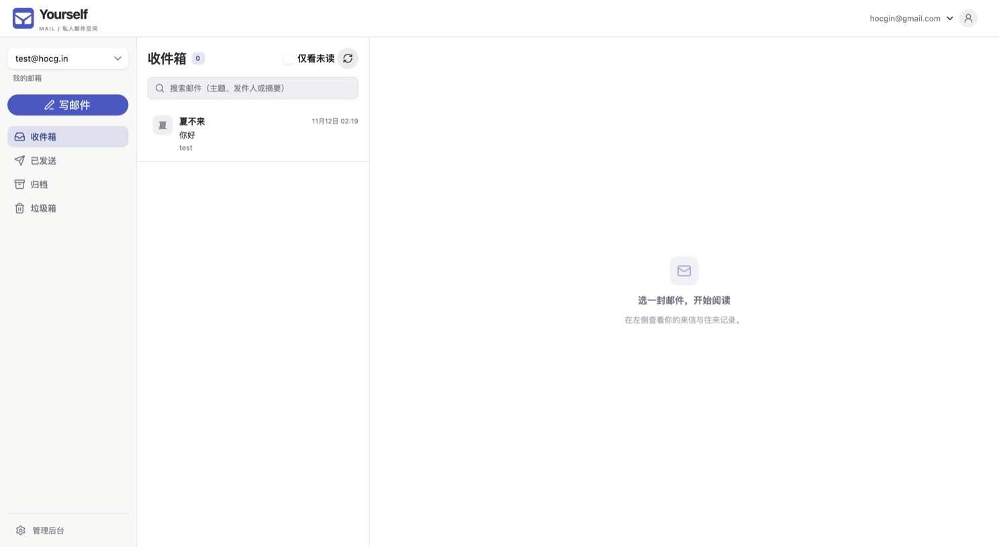
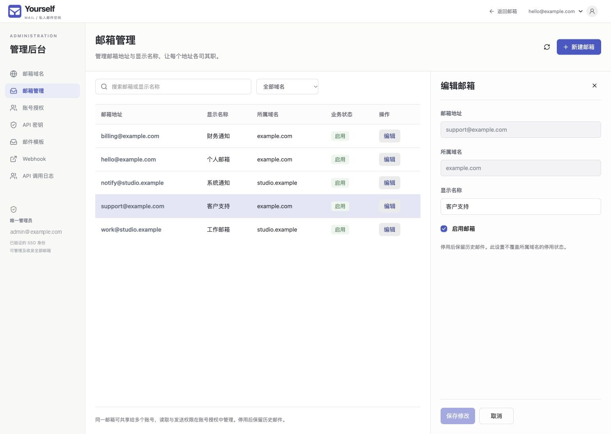
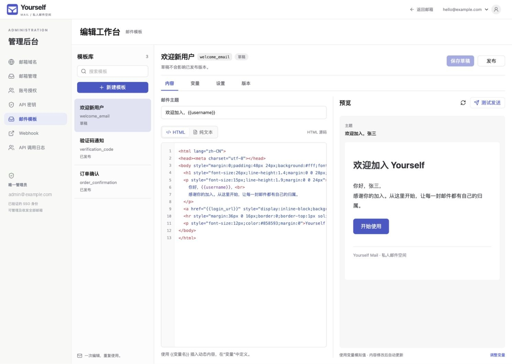
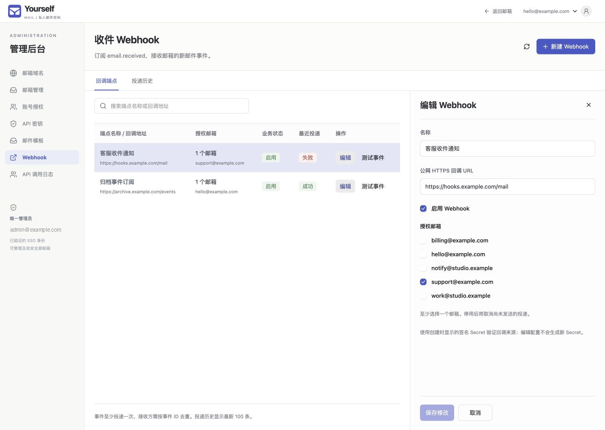

<div align="center">
  
  <h3><a href="https://mail.hocg.in">Yourself Mail</a></h3>
  <p><em>Build your own multi-domain email system on Cloudflare — no servers required</em></p>

  
  <a href="LICENSE"></a>
  <a href="docs/deployment.md"></a>
  <a href="./README.zh-CN.md"></a>
  <a href="./README.md"></a>
</div>

> Version 1.0.0 has been archived on the [1.x.x branch](https://github.com/hocgin/yourself-email/tree/1.x.x).

A multi-domain private email system running in a single Cloudflare Worker. React 19 + Vite + HeroUI v3 frontend, Hono API, Dove SSO standard OIDC login, D1 for metadata and a private R2 bucket for bodies and attachments. Inbound mail arrives via Email Routing; outbound mail is sent natively via Cloudflare Email Service.

`workers/` is the only application directory. The legacy Pages, Next.js, MailChannels and wildcard admin have been removed.

## Features

- **Multi-domain mailboxes**: manage multiple domains and mailboxes in one place, with manual mailbox creation, auto-creation on first inbound message, display names, and per-domain/per-mailbox enable toggles.
- **Send & receive**: receive via Email Routing and send via Cloudflare Email Service, with reply, CC, BCC, attachment upload/download, delivery status tracking, and edit-and-retry after failures.
- **Mail management**: inbox, sent, archive and trash folders, read/unread flags, unread filter, subject/sender/summary search, and conversation history.
- **SSO & shared access**: Dove SSO standard OIDC login; assign multiple mailboxes to each account with independent read and send permissions. Multiple accounts can share a mailbox and its mail state.
- **Admin console**: centrally manage domains, mailboxes, account grants, API keys, email templates, webhooks and API call logs, with both desktop and mobile layouts.
- **External API**: send/receive mail and read attachments per mailbox via Bearer API keys, with permission scopes, expiry, enable/revoke, per-minute and per-day quotas, and idempotent sending.
- **Email templates**: edit subject, HTML and plain-text bodies; define variables, default values and mock values, with sandboxed preview, test sends, draft versions, independent publishing, and per-mailbox availability limits.
- **Inbound webhooks**: subscribe to `email.received` per mailbox, with HMAC-SHA256 signatures, queue-based delivery, automatic retries, test events, delivery history and manual replay.
- **Storage & audit**: D1 stores metadata while private R2 stores bodies and attachments; email HTML is sanitized and rendered in a sandbox; API calls and admin operations are logged; expired sessions and unused attachments are cleaned up on a schedule.

## Screenshots

Local demo screenshots of the current interface, using sample data.

<table>
  <tr>
    <td width="50%">
      <p align="center"><strong>Mail Reading</strong></p>
      
    </td>
    <td width="50%">
      <p align="center"><strong>Mailbox Management</strong></p>
      
    </td>
  </tr>
  <tr>
    <td width="50%">
      <p align="center"><strong>Email Templates</strong></p>
      
    </td>
    <td width="50%">
      <p align="center"><strong>Inbound Webhooks</strong></p>
      
    </td>
  </tr>
</table>

## Local Development

Requires Node.js 22.12+ (24 recommended) and pnpm 10.32.1.

```sh
cd workers
corepack pnpm install
cp .dev.vars.example .dev.vars
pnpm db:migrate
pnpm dev
```

The dev server runs at `http://localhost:5173`. Without SSO configured you can still view the login page; signing in clearly reports the configuration error. For real logins, use an HTTPS tunnel and align `APP_URL` and the callback registered in SSO with that origin; cookies are always Secure.

```sh
pnpm cf:types
pnpm typecheck
pnpm test
pnpm deploy:check
```

Integration tests run on the Workers runtime with isolated local D1, R2 and mocked SSO/send interfaces — no real email is sent. The `EMAIL` binding under `pnpm dev` defaults to a local mock; enable remote bindings per the official Cloudflare docs to send for real.

## Permissions & Usage

- The single admin is designated by the `ADMIN_EMAIL` environment variable. After SSO verifies that email address, the account can manage and send/receive for every mailbox. If unset or invalid, no account is granted admin. Changes take effect on subsequent requests; the previous admin reverts to a normal account with its own grants.
- After adding a domain in the admin console, you can create mailboxes manually or let the first inbound message auto-create the matching mailbox; then configure each user's SSO login email with multiple mailboxes under "Account Grants". Read and send can be toggled independently; the account is bound to `(issuer, sub)` on first login.
- A mailbox can be shared with multiple accounts; read, archive and trash state is shared across them. Accounts without any grant only see the pending-assignment page.
- When an enabled, connected domain receives mail for an address that does not exist yet, a normal mailbox with an empty name and enabled state is created automatically; the admin can view and manage it after refreshing the mailbox list. It is not auto-granted to normal accounts. Disabling a domain or mailbox stops new send/receive; historical mail remains accessible to existing read grants; mail to non-connected domains is rejected. Plus-addresses are created as independent full addresses and are not mapped to the base address. Each domain's Email Routing must point its Catch-all at this Worker.
- A send status of "accepted by platform" does not imply final delivery; uncertain statuses are not automatically resent. Failed sends can be edited and retried. Uploaded attachments unused for 24 hours are cleaned up.

## Deployment

Follow the [full deployment guide](docs/deployment.md) to create **new** D1 and R2 resources, configure the SSO client, deploy, and switch domains over. Existing databases are not migrated or wiped.

Production requires `ADMIN_EMAIL`, `APP_URL`, `SSO_ISSUER`, `SSO_CLIENT_ID`, `SSO_RESOURCE`, the `SSO_CLIENT_SECRET` secret, plus the `DB`, `MAIL_STORAGE` and `EMAIL` bindings.

GitHub Actions runs checks on PRs and branches and deploys after `main` passes; production parameters come from the GitHub `production` environment's variables/secrets. The legacy Terraform config is only kept under `docs/legacy/` for rollback reference and no longer runs.

You can deploy with the help of an AI agent by following the guide above, or contact [the author](https://github.com/hocgin) for paid deployment assistance.

See [Architecture & API](docs/architecture.md) and [Validation records](docs/validation.md).

Live instance: [Yourself Mail](https://mail.hocg.in). Provisioned resources and real-SSO verification results are in the [release notes](docs/release.md).

## External API, Templates & Webhooks

Admins can create API keys authorized per mailbox address, maintain draft and published templates, and configure inbound webhooks. The external API uses a separate Bearer identity while keeping the existing SSO flow. For integration examples, scopes, quotas, signature verification, queues and migration config, see the [integration docs](workers/docs/external-api.md). Deployment requires creating a Webhook Queue and setting the `WEBHOOK_MASTER_KEY` secret.
