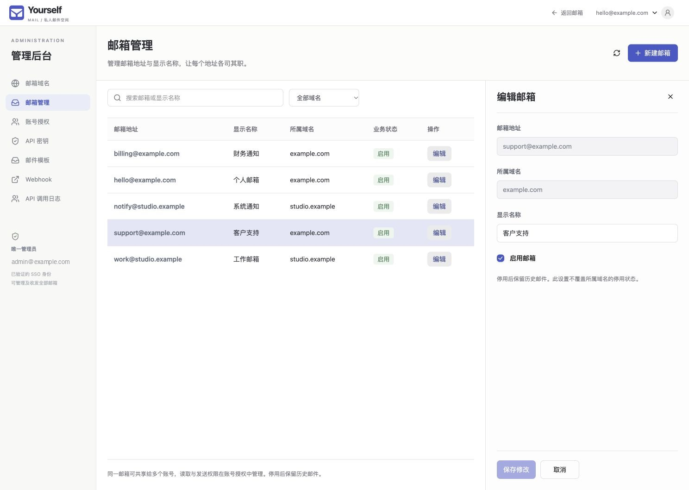
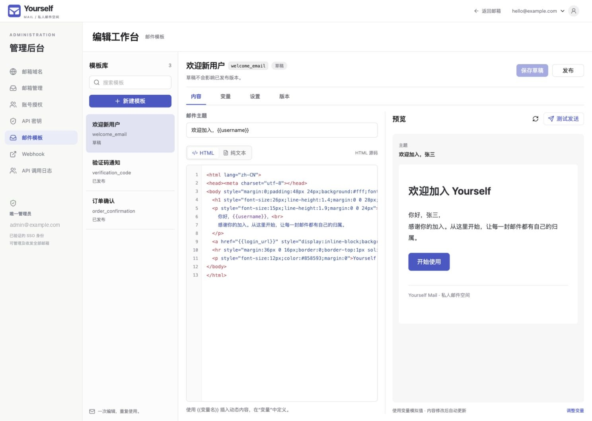
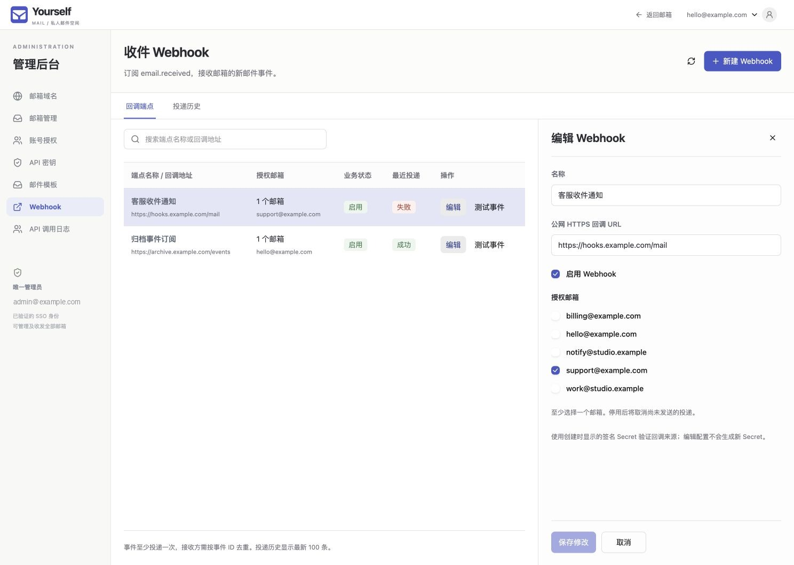

<div align="center">
  
  <h3><a href="https://mail.hocg.in">Yourself Mail</a></h3>
  <p><em>使用 Cloudflare 来构建你自己的多域名邮件系统，无需服务器</em></p>

  
  <a href="LICENSE"></a>
  <a href="docs/deployment.md"></a>
  <a href="./README.zh-CN.md"></a>
  <a href="./README.md"></a>
</div>

> 1.0.0 版本已归档至 [1.x.x 分支](https://github.com/hocgin/yourself-email/tree/1.x.x)。

部署在一个 Cloudflare Worker 中的多域名私人邮箱。React 19 + Vite + HeroUI v3 界面，Hono API，Dove SSO 标准 OIDC 登录，D1 元数据和私有 R2 正文／附件存储。通过 Email Routing 收信，通过 Cloudflare Email Service 原生发信。

唯一应用目录为 `workers/`。旧 Pages、Next.js、MailChannels 和通配管理员已移除。

## 功能清单

- **多域名邮箱**：统一管理多个域名与邮箱，支持手动建箱、首次来信自动建箱、显示名称及域名／邮箱启停。
- **邮件收发**：通过 Email Routing 收信、Cloudflare Email Service 发信，支持回复、抄送、密送、附件上传与下载，以及发送状态查询和失败后编辑重试。
- **邮件管理**：收件箱、已发送、归档、垃圾箱、已读／未读标记、未读筛选、主题／发件人／摘要搜索及会话记录。
- **SSO 与共享授权**：Dove SSO 标准 OIDC 登录，按账号分配多个邮箱，读取和发送权限独立配置；多个账号可共享邮箱与邮件状态。
- **管理后台**：域名、邮箱、账号授权、API 密钥、邮件模板、Webhook 和 API 调用日志集中管理，支持桌面与移动端布局。
- **外部 API**：通过 Bearer API Key 按邮箱授权收发邮件与读取附件，支持权限范围、有效期、停用／撤销、分钟／日配额和幂等发送。
- **邮件模板**：编辑主题、HTML 与纯文本，定义变量、默认值和模拟值，支持沙箱预览、测试发送、草稿版本、独立发布及可用邮箱限制。
- **收件 Webhook**：按邮箱订阅 `email.received`，提供 HMAC-SHA256 签名、队列投递、失败自动重试、测试事件、投递历史与手动重放。
- **存储与审计**：D1 保存元数据，私有 R2 保存正文与附件；邮件 HTML 净化与沙箱展示，记录 API 调用及管理员操作，定时清理过期会话和未使用附件。

## 界面预览

以下为当前界面的本地演示截图，使用示例数据。

**邮箱管理**：搜索与筛选邮箱，在侧栏编辑名称和启用状态。



**邮件模板**：在编辑工作台中维护内容、变量与版本，并预览渲染结果。



**收件 Webhook**：配置回调地址与订阅邮箱，查看投递历史。



## 本地开发

需要 Node.js 22.12+（推荐 24）及 pnpm 10.32.1。

```sh
cd workers
corepack pnpm install
cp .dev.vars.example .dev.vars
pnpm db:migrate
pnpm dev
```

开发地址 `http://localhost:5173`。没有配置 SSO 时可查看登录页，登录会明确返回配置错误。实际登录建议使用 HTTPS 隧道并将 `APP_URL` 及 SSO 中登记的回调统一为该 origin；Cookie 始终使用 Secure。

```sh
pnpm cf:types
pnpm typecheck
pnpm test
pnpm deploy:check
```

集成测试在 Workers 运行时运行，使用隔离的本地 D1、R2 和模拟的 SSO／发送接口，不发送真实邮件。`pnpm dev` 的 `EMAIL` 绑定默认为本地模拟；按 Cloudflare 官方文档启用远程绑定才会真实发信。

## 权限与使用

- 唯一管理员由环境变量 `ADMIN_EMAIL` 指定，通过 SSO 验证邮箱后可以管理并收发所有邮箱。未配置或配置无效时不授予任何账号管理员权限。修改后在后续请求中生效，原管理员按普通账号授权访问。
- 管理后台添加域名后，可手动创建邮箱，或由首次来信自动创建对应邮箱；再在「账号授权」按用户的 SSO 登录邮箱配置多个邮箱。读取和发送可分别勾选，首次登录后绑定 `(issuer, sub)`。
- 同一邮箱可共享给多个账号，已读、归档和垃圾箱状态共享。无授权账号只能看到待分配页面。
- 启用中的接入域名收到未创建地址的邮件时，会自动创建名称为空、状态启用的普通邮箱，管理员刷新邮箱列表后即可查看和管理；不会自动授权给普通账号。停用域名或邮箱会停止新收发，历史邮件仍可由原有读权限访问；未接入域名拒收。加号地址作为独立完整地址建箱，不映射到基础地址。每个域名的 Email Routing 需配置 Catch-all 指向本 Worker。
- 发送状态「平台已接受」不表示最终投递；不确定状态不会自动重发。发送失败可编辑后重试。上传附件 24 小时未使用会被清理。

## 部署

按 [完整部署指南](docs/deployment.md) 创建**新的** D1 和 R2、配置 SSO 客户端、部署及切换域名。旧数据库不会被迁移或清空。

生产配置需要 `ADMIN_EMAIL`、`APP_URL`、`SSO_ISSUER`、`SSO_CLIENT_ID`、`SSO_RESOURCE`、Secret `SSO_CLIENT_SECRET` 以及 `DB`、`MAIL_STORAGE`、`EMAIL` 绑定。

GitHub Actions 在 PR 和分支执行检查，在 `main` 检查成功后部署；生产参数使用 GitHub `production` environment 的 variables/secrets。旧 Terraform 配置仅保存在 `docs/legacy/` 供回退参考，不再运行。

详见 [架构与 API](docs/architecture.md) 和 [验收记录](docs/validation.md)。

当前线上实例：[Yourself Mail](https://mail.hocg.in)。资源与真实 SSO 验证结果见 [发布记录](docs/release.md)。

## 外部 API、模板与 Webhook

管理员可创建按邮箱地址授权的 API Key、维护草稿与发布模板，并配置收件 Webhook。外部 API 使用独立 Bearer 身份，保留现有 SSO 流程。接入示例、权限、配额、签名验证、队列及迁移配置见 [接入文档](workers/docs/external-api.md)。部署时需创建 Webhook Queue 并配置 `WEBHOOK_MASTER_KEY` Secret。
